# Symbol review

Every starter button and the ARASAAC pictogram chosen for it. Look for bad matches;
to fix one, find a better pictogram on https://arasaac.org, put its number in
`tools/symbol_keywords.json` as `"<button id>": {"id": <number>}` (or a better search
word), then run `python3 tools/fetch_symbols.py --all` and `python3 tools/build_sw.py`.

Pictograms: Sergio Palao. Property of the Government of Aragón. ARASAAC (https://arasaac.org).
Licence CC BY-NC-SA 4.0.

| Button id | Board | English | Hindi | Search word | ARASAAC id | Picture | Status |
|---|---|---|---|---|---|---|---|
| core-0 | core | I | मैं | I | [2617](https://arasaac.org/pictograms/en/2617) | 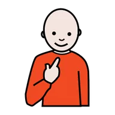 | kept |
| core-1 | core | you | आप | you | [2608](https://arasaac.org/pictograms/en/2608) | 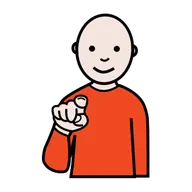 | kept |
| core-2 | core | want | चाहिए | want | [5441](https://arasaac.org/pictograms/en/5441) | 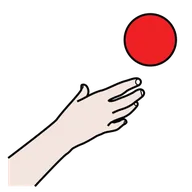 | kept |
| core-3 | core | don't want | नहीं चाहिए | (pinned after review) | [6156](https://arasaac.org/pictograms/en/6156) | 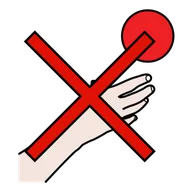 | kept |
| core-4 | core | yes | हाँ | yes | [5583](https://arasaac.org/pictograms/en/5583) | 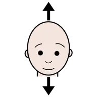 | kept |
| core-5 | core | no | नहीं | no | [5525](https://arasaac.org/pictograms/en/5525) | 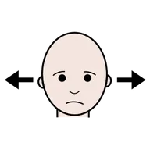 | kept |
| core-6 | core | mine | मेरा | (pinned after review) | [12264](https://arasaac.org/pictograms/en/12264) | 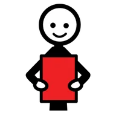 | kept |
| core-7 | core | help | मदद | help | [4570](https://arasaac.org/pictograms/en/4570) |  | kept |
| core-8 | core | go | जाना | go | [2432](https://arasaac.org/pictograms/en/2432) | 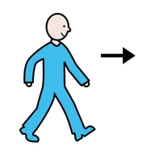 | kept |
| core-9 | core | come | आओ | come | [11708](https://arasaac.org/pictograms/en/11708) | 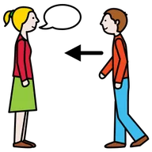 | kept |
| core-10 | core | stop | रुको | (pinned after review) | [7195](https://arasaac.org/pictograms/en/7195) | 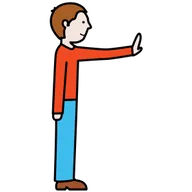 | kept |
| core-11 | core | more | और | more | [5508](https://arasaac.org/pictograms/en/5508) | 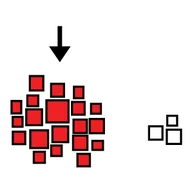 | kept |
| core-12 | core | this | यह | this | [7095](https://arasaac.org/pictograms/en/7095) | 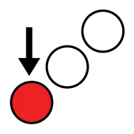 | kept |
| core-13 | core | that | वह | that | [6906](https://arasaac.org/pictograms/en/6906) | 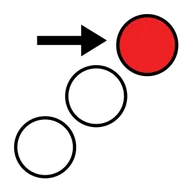 | kept |
| core-14 | core | like | पसंद है | like | [2418](https://arasaac.org/pictograms/en/2418) | 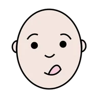 | kept |
| core-15 | core | look | देखो | look | [2474](https://arasaac.org/pictograms/en/2474) | 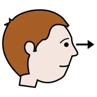 | kept |
| core-16 | core | again | फिर से | again | [37163](https://arasaac.org/pictograms/en/37163) | 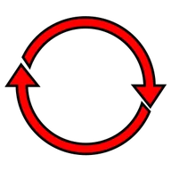 | kept |
| core-17 | core | finished | खत्म | finished | [28429](https://arasaac.org/pictograms/en/28429) |  | kept |
| core-18 | core | here | यहाँ | here | [5382](https://arasaac.org/pictograms/en/5382) | 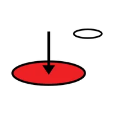 | kept |
| core-19 | core | there | वहाँ | there | [5375](https://arasaac.org/pictograms/en/5375) | 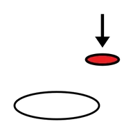 | kept |
| core-20 | core | eat | खाना | eat | [2349](https://arasaac.org/pictograms/en/2349) |  | kept |
| core-21 | core | drink | पीना | drink | [2276](https://arasaac.org/pictograms/en/2276) | 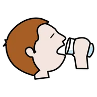 | kept |
| core-22 | core | good | अच्छा | good | [4581](https://arasaac.org/pictograms/en/4581) | 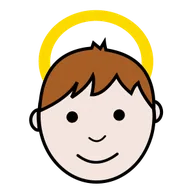 | kept |
| core-23 | core | bad | बुरा | bad | [4690](https://arasaac.org/pictograms/en/4690) |  | kept |
| core-24 | core | in | में | in | [7034](https://arasaac.org/pictograms/en/7034) |  | kept |
| core-25 | core | on | पर | on | [7814](https://arasaac.org/pictograms/en/7814) | 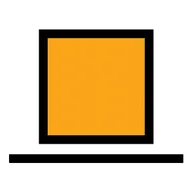 | kept |
| core-26 | core | play | खेलना | play | [2439](https://arasaac.org/pictograms/en/2439) | 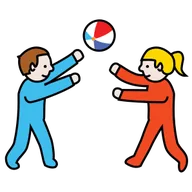 | kept |
| core-27 | core | give | दो | give | [17038](https://arasaac.org/pictograms/en/17038) | 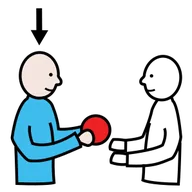 | kept |
| core-28 | core | up | ऊपर | up | [5388](https://arasaac.org/pictograms/en/5388) | 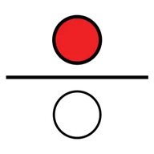 | kept |
| core-29 | core | down | नीचे | down | [37428](https://arasaac.org/pictograms/en/37428) | 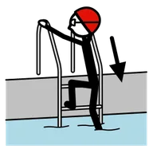 | kept |
| core-30 | core | what | क्या | what | [22620](https://arasaac.org/pictograms/en/22620) |  | kept |
| core-31 | core | where | कहाँ | where | [7764](https://arasaac.org/pictograms/en/7764) |  | kept |
| core-32 | core | open | खोलो | open | [4549](https://arasaac.org/pictograms/en/4549) | 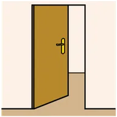 | kept |
| core-33 | core | my turn | मेरी बारी | turn | [6006](https://arasaac.org/pictograms/en/6006) | 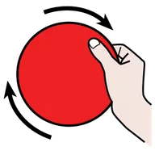 | kept |
| core-34 | core | please | प्लीज़ | please | [8194](https://arasaac.org/pictograms/en/8194) | 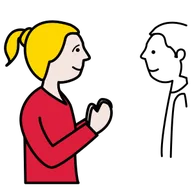 | kept |
| core-35 | core | thank you | धन्यवाद | thank you | [8129](https://arasaac.org/pictograms/en/8129) |  | kept |
| needs-0 | needs | yes | हाँ | yes | [5583](https://arasaac.org/pictograms/en/5583) |  | kept |
| needs-1 | needs | no | नहीं | no | [5525](https://arasaac.org/pictograms/en/5525) |  | kept |
| needs-2 | needs | help | मदद | help | [4570](https://arasaac.org/pictograms/en/4570) | 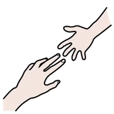 | kept |
| needs-3 | needs | stop | रुको | (pinned after review) | [7195](https://arasaac.org/pictograms/en/7195) |  | kept |
| needs-4 | needs | more | और | more | [5508](https://arasaac.org/pictograms/en/5508) |  | kept |
| needs-5 | needs | finished | खत्म | finished | [28429](https://arasaac.org/pictograms/en/28429) | 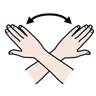 | kept |
| needs-6 | needs | toilet | टॉयलेट | toilet | [2430](https://arasaac.org/pictograms/en/2430) |  | kept |
| needs-7 | needs | water | पानी | water | [2248](https://arasaac.org/pictograms/en/2248) |  | kept |
| needs-8 | needs | break | आराम | rest | [3299](https://arasaac.org/pictograms/en/3299) | 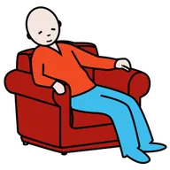 | kept |
| needs-9 | needs | hurts | दर्द | pain | [2367](https://arasaac.org/pictograms/en/2367) | 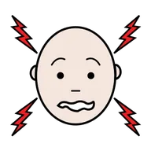 | kept |
| food-0 | food | eat | खाना | eat | [2349](https://arasaac.org/pictograms/en/2349) | 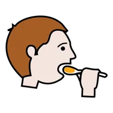 | kept |
| food-1 | food | roti | रोटी | — | — | — | emoji kept (no good match) |
| food-2 | food | rice | चावल | rice | [6911](https://arasaac.org/pictograms/en/6911) | 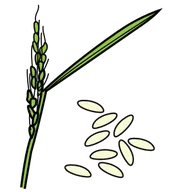 | kept |
| food-3 | food | dal | दाल | lentils | [2448](https://arasaac.org/pictograms/en/2448) | 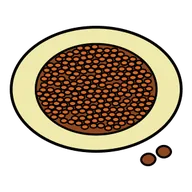 | kept |
| food-4 | food | milk | दूध | milk | [2445](https://arasaac.org/pictograms/en/2445) | 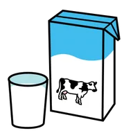 | kept |
| food-5 | food | banana | केला | banana | [2530](https://arasaac.org/pictograms/en/2530) | 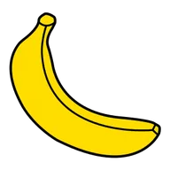 | kept |
| food-6 | food | mango | आम | mango | [16813](https://arasaac.org/pictograms/en/16813) | 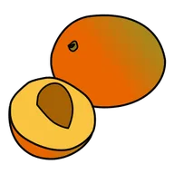 | kept |
| food-7 | food | biscuit | बिस्कुट | biscuit | [8312](https://arasaac.org/pictograms/en/8312) | 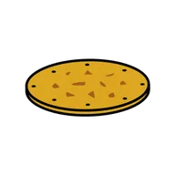 | kept |
| food-8 | food | juice | जूस | juice | [11461](https://arasaac.org/pictograms/en/11461) | 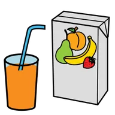 | kept |
| food-9 | food | hungry | भूख | hungry | [4962](https://arasaac.org/pictograms/en/4962) | 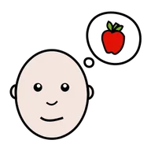 | kept |
| food-10 | food | idli | इडली | — | — | — | emoji kept (no good match) |
| food-11 | food | dosa | डोसा | crepe | [34233](https://arasaac.org/pictograms/en/34233) | 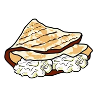 | kept |
| feelings-0 | feelings | happy | खुश | happy | [3245](https://arasaac.org/pictograms/en/3245) | 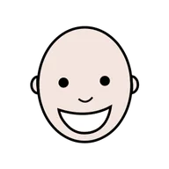 | kept |
| feelings-1 | feelings | sad | उदास | sad | [2606](https://arasaac.org/pictograms/en/2606) | 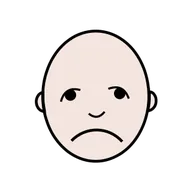 | kept |
| feelings-2 | feelings | angry | गुस्सा | angry | [2374](https://arasaac.org/pictograms/en/2374) | 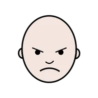 | kept |
| feelings-3 | feelings | scared | डर | scared | [2261](https://arasaac.org/pictograms/en/2261) | 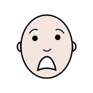 | kept |
| feelings-4 | feelings | tired | थकान | tired | [2314](https://arasaac.org/pictograms/en/2314) | 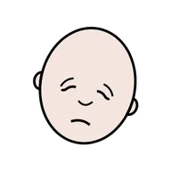 | kept |
| feelings-5 | feelings | sick | बीमार | sick | [3308](https://arasaac.org/pictograms/en/3308) | 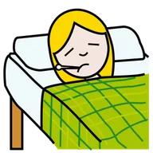 | kept |
| feelings-6 | feelings | excited | मज़ा | excited | [39090](https://arasaac.org/pictograms/en/39090) |  | kept |
| feelings-7 | feelings | calm | शांत | calm | [31310](https://arasaac.org/pictograms/en/31310) | 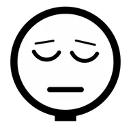 | kept |
| feelings-8 | feelings | too loud | बहुत शोर | noise | [7157](https://arasaac.org/pictograms/en/7157) | 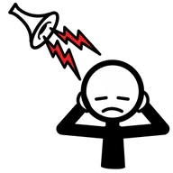 | kept |
| feelings-9 | feelings | love | प्यार | love | [6600](https://arasaac.org/pictograms/en/6600) |  | kept |
| people-0 | people | I | मैं | I | [2617](https://arasaac.org/pictograms/en/2617) |  | kept |
| people-1 | people | you | आप | you | [2608](https://arasaac.org/pictograms/en/2608) |  | kept |
| people-2 | people | mummy | मम्मी | mother | [2458](https://arasaac.org/pictograms/en/2458) |  | kept |
| people-3 | people | papa | पापा | father | [2497](https://arasaac.org/pictograms/en/2497) |  | kept |
| people-4 | people | didi | दीदी | sister | [2422](https://arasaac.org/pictograms/en/2422) |  | kept |
| people-5 | people | bhaiya | भैया | brother | [2423](https://arasaac.org/pictograms/en/2423) |  | kept |
| people-6 | people | dadi | दादी | grandmother | [2243](https://arasaac.org/pictograms/en/2243) |  | kept |
| people-7 | people | dada | दादा | grandfather | [2244](https://arasaac.org/pictograms/en/2244) |  | kept |
| people-8 | people | teacher | टीचर | teacher | [2457](https://arasaac.org/pictograms/en/2457) |  | kept |
| people-9 | people | friend | दोस्त | friend | [8486](https://arasaac.org/pictograms/en/8486) |  | kept |
| places-0 | places | home | घर | home | [6964](https://arasaac.org/pictograms/en/6964) |  | kept |
| places-1 | places | school | स्कूल | school | [3082](https://arasaac.org/pictograms/en/3082) |  | kept |
| places-2 | places | park | पार्क | park | [5379](https://arasaac.org/pictograms/en/5379) |  | kept |
| places-3 | places | shop | दुकान | shop | [8986](https://arasaac.org/pictograms/en/8986) |  | kept |
| places-4 | places | hospital | अस्पताल | hospital | [3116](https://arasaac.org/pictograms/en/3116) |  | kept |
| places-5 | places | temple | मंदिर | — | — | — | emoji kept (no good match) |
| places-6 | places | outside | बाहर | (pinned after review) | [2806](https://arasaac.org/pictograms/en/2806) |  | kept |
| places-7 | places | car | गाड़ी | car | [2339](https://arasaac.org/pictograms/en/2339) |  | kept |
| places-8 | places | bus | बस | bus | [2262](https://arasaac.org/pictograms/en/2262) |  | kept |
| places-9 | places | grandma's house | नानी का घर | (pinned after review) | [30482](https://arasaac.org/pictograms/en/30482) |  | kept |
| home-0 | home | bed | बिस्तर | bed | [2304](https://arasaac.org/pictograms/en/2304) |  | kept |
| home-1 | home | bath | नहाना | bath | [2272](https://arasaac.org/pictograms/en/2272) |  | kept |
| home-2 | home | brush teeth | ब्रश करना | brush one's teeth | [39965](https://arasaac.org/pictograms/en/39965) |  | kept |
| home-3 | home | clothes | कपड़े | (pinned after review) | [7233](https://arasaac.org/pictograms/en/7233) |  | kept |
| home-4 | home | TV | टीवी | TV | [25498](https://arasaac.org/pictograms/en/25498) |  | kept |
| home-5 | home | phone | फ़ोन | (pinned after review) | [25269](https://arasaac.org/pictograms/en/25269) |  | kept |
| home-6 | home | fan | पंखा | fan | [2612](https://arasaac.org/pictograms/en/2612) |  | kept |
| home-7 | home | light | लाइट | (pinned after review) | [4936](https://arasaac.org/pictograms/en/4936) |  | kept |
| home-8 | home | door | दरवाज़ा | door | [3244](https://arasaac.org/pictograms/en/3244) |  | kept |
| home-9 | home | sleep | सोना | sleep | [2369](https://arasaac.org/pictograms/en/2369) |  | kept |
| play-0 | play | play | खेलना | play | [2439](https://arasaac.org/pictograms/en/2439) |  | kept |
| play-1 | play | ball | गेंद | ball | [2269](https://arasaac.org/pictograms/en/2269) |  | kept |
| play-2 | play | slide | फिसलपट्टी | slide | [4759](https://arasaac.org/pictograms/en/4759) |  | kept |
| play-3 | play | blocks | ब्लॉक | blocks | [4921](https://arasaac.org/pictograms/en/4921) |  | kept |
| play-4 | play | music | गाना | music | [24795](https://arasaac.org/pictograms/en/24795) |  | kept |
| play-5 | play | colours | रंग | colours | [5968](https://arasaac.org/pictograms/en/5968) |  | kept |
| play-6 | play | book | किताब | book | [2450](https://arasaac.org/pictograms/en/2450) |  | kept |
| play-7 | play | puzzle | पहेली | puzzle | [2540](https://arasaac.org/pictograms/en/2540) |  | kept |
| play-8 | play | bubbles | बुलबुले | bubbles | [6945](https://arasaac.org/pictograms/en/6945) |  | kept |
| play-9 | play | run | दौड़ना | run | [2719](https://arasaac.org/pictograms/en/2719) |  | kept |
| school-0 | school | bag | बस्ता | (pinned after review) | [2475](https://arasaac.org/pictograms/en/2475) |  | kept |
| school-1 | school | pencil | पेंसिल | pencil | [2440](https://arasaac.org/pictograms/en/2440) |  | kept |
| school-2 | school | write | लिखना | write | [2380](https://arasaac.org/pictograms/en/2380) |  | kept |
| school-3 | school | read | पढ़ना | read | [5973](https://arasaac.org/pictograms/en/5973) |  | kept |
| school-4 | school | draw | चित्र बनाना | (pinned after review) | [8088](https://arasaac.org/pictograms/en/8088) |  | kept |
| school-5 | school | tiffin | टिफ़िन | lunch box | [31091](https://arasaac.org/pictograms/en/31091) |  | kept |
| school-6 | school | I don't understand | मुझे समझ नहीं आया | not understand | [11315](https://arasaac.org/pictograms/en/11315) |  | kept |
| school-7 | school | work done | काम हो गया | finished | [28429](https://arasaac.org/pictograms/en/28429) |  | kept |
| school-8 | school | quiet | शांति | silence | [5936](https://arasaac.org/pictograms/en/5936) |  | kept |
| school-9 | school | wait | ज़रा रुको | wait | [8109](https://arasaac.org/pictograms/en/8109) |  | kept |
| morning-0 | morning | wake up | उठना | get up | [6548](https://arasaac.org/pictograms/en/6548) |  | kept |
| morning-1 | morning | toilet | टॉयलेट | toilet | [2430](https://arasaac.org/pictograms/en/2430) |  | kept |
| morning-2 | morning | brush teeth | ब्रश करना | brush one's teeth | [39965](https://arasaac.org/pictograms/en/39965) |  | kept |
| morning-3 | morning | bath | नहाना | bath | [2272](https://arasaac.org/pictograms/en/2272) |  | kept |
| morning-4 | morning | get dressed | कपड़े पहनना | get dressed | [2781](https://arasaac.org/pictograms/en/2781) |  | kept |
| morning-5 | morning | breakfast | नाश्ता | breakfast | [4625](https://arasaac.org/pictograms/en/4625) |  | kept |
| morning-6 | morning | milk | दूध | milk | [2445](https://arasaac.org/pictograms/en/2445) |  | kept |
| morning-7 | morning | school bag | बस्ता | (pinned after review) | [2475](https://arasaac.org/pictograms/en/2475) |  | kept |
| bedtime-0 | bedtime | pyjamas | नाइट सूट | pyjamas | [2522](https://arasaac.org/pictograms/en/2522) |  | kept |
| bedtime-1 | bedtime | brush teeth | ब्रश करना | brush one's teeth | [39965](https://arasaac.org/pictograms/en/39965) |  | kept |
| bedtime-2 | bedtime | story | कहानी | (pinned after review) | [8346](https://arasaac.org/pictograms/en/8346) |  | kept |
| bedtime-3 | bedtime | hug | गले लगाओ | hug | [4550](https://arasaac.org/pictograms/en/4550) |  | kept |
| bedtime-4 | bedtime | light off | लाइट बंद करो | turn off the light | [8027](https://arasaac.org/pictograms/en/8027) |  | kept |
| bedtime-5 | bedtime | water | पानी | water | [2248](https://arasaac.org/pictograms/en/2248) |  | kept |
| bedtime-6 | bedtime | sleep | सोना | sleep | [2369](https://arasaac.org/pictograms/en/2369) |  | kept |
| family-0 | family | mummy | मम्मी | mother | [2458](https://arasaac.org/pictograms/en/2458) |  | kept |
| family-1 | family | papa | पापा | father | [2497](https://arasaac.org/pictograms/en/2497) |  | kept |
| pets-0 | pets | dog | कुत्ता | dog | [2517](https://arasaac.org/pictograms/en/2517) |  | kept |
| pets-1 | pets | cat | बिल्ली | cat | [2406](https://arasaac.org/pictograms/en/2406) |  | kept |
